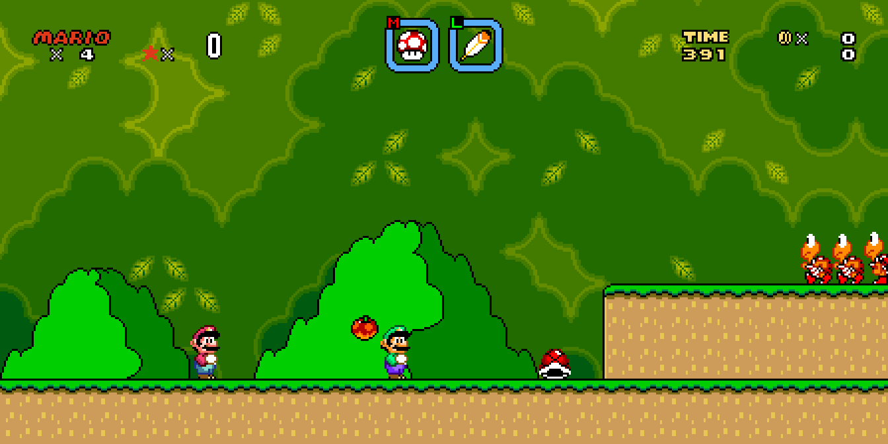
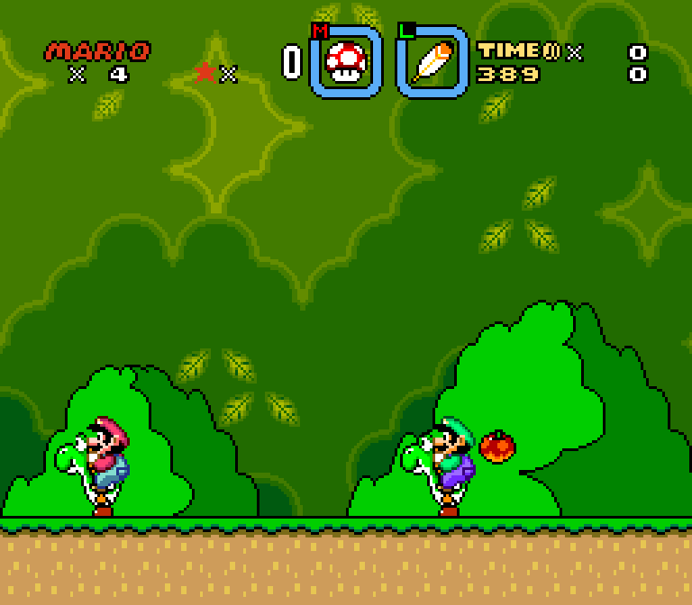

# SuperMarioWorldRecomp

> _This recompilation is a **byproduct of developing
> [snesrecomp](https://github.com/mstan/snesrecomp)** — the games are the proving ground, the framework is the goal.
> **These are in-development previews, not finished ports — expect rough
> edges**, and depth will keep landing over months, not days. My time for any
> one title is limited, so I ask for your patience. Contributions are welcome —
> testing, issues, and PRs to the game or framework all help and will
> accelerate this game's polish. More on the why at:
> [Recomp + AI: 5 Months Later »](https://1379.tech/recomp-ai-5-months-later/)_

Static recompilation of *Super Mario World* (SNES) into native C,
using the [snesrecomp](https://github.com/mstan/snesrecomp) framework.
This repo is the per-game side: the runtime, the recompiled C output,
the per-game `.cfg`, and the build glue.

## What "static recompilation" means here

The 65816 CPU code from the ROM is statically translated to C — every
function the game runs on the SNES's main CPU is a real generated C
function in `src/gen/`. **The rest of the SNES is not recompiled** —
it's hardware. PPU rendering, the APU / SPC700 audio coprocessor, DMA
and HDMA channels, hardware register I/O, and bank-mapping all run
through a C reimplementation of the SNES hardware in
`snesrecomp/runner/src/snes/` — a [LakeSnes](https://github.com/elzo-d/LakeSnes)-derived
core (the same emulator family the [snesrev](https://github.com/snesrev)
reverse-engineered ports use), with individual algorithms credited to
snes9x. This is the same model other static-recomp projects (N64Recomp,
snesrev/zelda3, etc.) use: recompile the CPU, emulate the silicon. If
you expected the PPU and APU to be recompiled
too, they aren't — and a static recompiler can't recompile them
because the SNES PPU has no instruction stream and the SPC700 is a
separate processor with its own firmware that the cartridge uploads
to a separate chip.

## Current status: believed fully playable

Hand-verified end-to-end through:
- **Yoshi's Island (World 1)** including Iggy's castle boss.
- **Donut Plains (World 2)** end-to-end.
- **Vanilla Dome (World 3)** in progress at time of writing.

No catastrophic visible regressions surfaced through these worlds.
Two runtime tripwires (the M/X claim verifier and the
async-cpu->m_flag/x_flag-write detector) are armed at boot and have
not latched on the verified worlds. An off-rails event was captured
in `BufferScrollingTiles_Layer1_VerticalLevel_M1X1` during Donut
Plains castle (bank-out-of-range pointer read; runtime mirrors the
read to a safe location and gameplay continues) — see
[`ISSUES.md`](ISSUES.md) for the bucketed capture and the
`offrails_get` TCP query.

Worlds 4–7 and special content (Star Road, Special World) are not
yet hand-verified but are expected to play similarly. If you hit a
visible regression, please open an issue with a savestate and the
`offrails_get` / `mx_async_check_get` JSON snapshots.

Active development; expect:
- Some branches don't build; only `main` is guaranteed to build.
- Internal docs (`ISSUES.md`, `ENHANCEMENTS.md`) assume context.
- APIs and recompiler output change without notice.

See [`RELEASE.md`](RELEASE.md) for the latest release notes.

## Quick start (pre-built release)

1. Download the Windows ZIP or Linux AppImage from
   [Releases](../../releases). Extract the ZIP, or make the AppImage executable.
2. Run `SuperMarioWorldSNESRecomp.exe` or the AppImage. On first launch a file picker asks for your
   **legally-obtained** Super Mario World (USA) ROM (`.sfc` / `.smc`).
   The path is remembered in `rom.cfg` next to the exe.
3. Edit `keybinds.ini` (auto-generated next to the exe on first run)
   to remap keys, then restart.

The ROM is **never** redistributed — supply your own dump.

To play as Captain Falcon, enable **Captain Falcon** on the launcher's Mods page,
select your **Super Smash Bros. (USA) v1.0** ROM, and press Play. The included
helper prepares Falcon's assets in your user cache on first use. No Python
installation or environment setup is required.

## Optional Lua scripting

The Windows/Linux packages include an opt-in localhost Lua server and
a `lua/` folder with a **100-fireballs-per-second** hold-to-fire example.
See [lua/README.md](lua/README.md) for activation and controls. Nothing runs or
listens during ordinary play. Source builds enable this with
`-DSNESRECOMP_ENABLE_LUA=ON`; the framework option defaults OFF.

## Widescreen

Enable **SMW Adaptive Widescreen** in the launcher's **Mods** page.
Its two controls are **Aspect ratio** (Fit to screen by default, plus fixed
4:3 through 100:9 choices) and **Enemy spawn behavior** (Screen-based by
default, or Original 4:3 activation). The HUD anchors automatically: lives and
bonus counters left, reserve item centered, TIME/coins/score right.

This experimental host renderer replaces the former PPU-expansion mod. Fit
follows the live window or fullscreen aspect, with native pixel proportions
and 224 lines; 100:9 renders 2134 columns without wrapping enemy coordinates.
Title screens, the overworld, transitions, and unsupported PPU modes retain
their native view. The original enemy-slot pool still limits how many enemies
can be active across very wide views.

See [the renderer guide](docs/adaptive-renderer.md) for building, isolated
playtesting, architecture, checks, and current limitations. Old `Widescreen`
and `WidescreenHud` INI fields no longer control this mod.

## Experimental native simultaneous co-op

**Playable prototype ? experimental and disabled by default.** Mario (P1) and
Luigi (P2) play together on one screen using the normal executable and an
unmodified Super Mario World (USA) ROM.

1. Assign both players' controllers or keyboard bindings in the recomp UI.
2. Open **Mods**, enable **Simultaneous co-op (Experimental)** in
   **SMW Native Co-op (Experimental)**, then press **Play**.
3. Use the original save-file menus and select **2 Player**. Co-op saves and
   save states are stored separately from regular play. **1 Player** retains
   ordinary solo behavior.

The prototype includes independent movement, powerups, reserve items and
ordinary Yoshi riding; shared enemy outcomes and rewards; recovery bubbles;
and a shared camera. The reserve boxes use the original artwork with M/L
badges. It also works with **SMW Adaptive Widescreen**. The overworld and
special scenes use the original single lead.



*Mario and Luigi together in an adaptive widescreen view.*



*Separate riders and reserve items in the native view.*

This is an early prototype, with representative common interactions tested
and owner playtesting completed. Some unusual combinations can still behave
incorrectly. A known example is bubble recovery interrupting a Yoshi berry
bite. Full campaign coverage, rare Yoshi/ability combinations, special
platforms, exceptional transitions and broader boss/controller/platform
qualification remain follow-up work. Please report bugs with reproduction
steps, your build version and a co-op save state when possible.

See the [implementation and product rules](docs/NATIVE_COOP.md),
[validation evidence](docs/validation/native-coop-common-followup-2026-10-20.md)
and [known issues and deferred checks](docs/NATIVE_COOP_DEFERRED.md).

The older separate IPS-based executable and its netplay instructions are
archived in [Legacy IPS co-op](docs/legacy-ips-coop.md).

## Controls (default `keybinds.ini`)

| SNES button | Default key |
|-------------|-------------|
| D-Pad       | Arrow keys |
| A           | X |
| B           | Z |
| X           | S |
| Y           | A |
| L           | C |
| R           | V |
| Start       | Enter |
| Select      | Right Shift |

Player 2 is unbound by default — fill in keys in `keybinds.ini` to enable a
second keyboard player. With the experimental native co-op mod enabled and
2 Player selected, the two bindings control Mario and Luigi simultaneously.

**Xbox / PlayStation / Switch Pro controllers** are auto-detected via
SDL_GameController (XInput on Windows). Plug it in before launching,
or hot-plug after. Default Xbox mapping is **position-true**: the
physical button position matches a SNES pad — so Xbox A (south face)
sends SNES B, Xbox B (east face) sends SNES A. To rebind, edit the
`[GamepadMap]` section of `config.ini` (auto-generated next to the exe
on first run); the recognized names and the full mapping table are
in [`CONTROLLER.md`](CONTROLLER.md).

System shortcuts (configured in `config.ini`'s `[KeyMap]` section):

| Action          | Default     |
|-----------------|-------------|
| Save state 1-10 | Shift+F1..F10 |
| Load state 1-10 | F1..F10 |
| Toggle pause    | P |
| Reset           | Ctrl+R |
| Toggle fullscreen | Alt+Enter |
| Turbo (fast-forward) | Tab |
| Toggle renderer | R |
| Display perf    | F |

## Building from source

For the native co-op prototype, use the standard stock-ROM CMake target
described in the [adaptive renderer build guide](docs/adaptive-renderer.md).
The `--coop`/`SMW_BUILD_COOP` options below select the legacy IPS executable.

Prerequisites: Windows 10+, Visual Studio 2022 (with C++ desktop
workload), Python 3.9+ on PATH, and `rustup` for regeneration.

```bash
git clone --recurse-submodules https://github.com/mstan/SuperMarioWorldRecomp
cd SuperMarioWorldRecomp
```

Regenerate the desired variant from your legally obtained stock ROM, then
build it. The generated C is intentionally untracked:

```bash
# Normal stock-ROM build (the default)
bash tools/regen.sh --stock
msbuild smw.sln /p:Configuration=Production /p:Platform=x64 /m

# Legacy IPS co-op build (optional)
bash tools/regen.sh --coop
msbuild smw.sln /p:Configuration=CoopProduction /p:Platform=x64 /m
```

The normal configuration remains `smw.exe`; the additive configuration creates
`SuperMarioWorldCoopSNESRecomp.exe` in its own output directory and copies
`smw_coop.ips` beside it. CMake builds the normal target by default; configure
with `-DSMW_BUILD_COOP=ON` to make both targets available in one build tree.

The legacy netplay-enabled IPS co-op target uses CMake so it can link recomp-net. A sibling
engine worktree can be selected without replacing the checked-in submodule:

```powershell
$engine = 'F:\path\to\snesrecomp-worktree'
$ui = 'F:\path\to\recomp-ui-worktree'
$sdl3 = 'F:\path\to\SDL3'
$env:SNESRECOMP_ROOT = $engine
bash tools/regen.sh --coop --no-tests
cmake -S . -B build-netplay -DSMW_BUILD_COOP=ON `
  -DSNESRECOMP_ROOT="$engine" -DRECOMP_UI_ROOT="$ui" `
  -DCMAKE_PREFIX_PATH="$sdl3" `
  -DSMW_NETPLAY_ICE=ON
cmake --build build-netplay --config Release `
  --target SuperMarioWorldCoopSNESRecomp --parallel
```

SDL3 is the default desktop backend. To build the maintained compatibility
fallback, configure a separate tree with
`-DSNESRECOMP_SDL_BACKEND=SDL2`.

### Regenerating the recompiled C (contributors)

If you change anything under `recomp/bank_*.cfg`, the snesrecomp
framework, or otherwise need to re-run the recompiler:

1. Drop a legally-obtained `smw.sfc` at the repo root (`.gitignore`
   excludes it).
2. Run `bash tools/regen.sh --stock` for the normal build and/or
   `bash tools/regen.sh --coop` for the legacy IPS build. Stock emits to `src/gen/` from the
   vanilla SMW (USA) ROM. Co-op applies the bundled IPS to a throwaway verified
   ROM, layers the small CFG fragments in `recomp/coop/`, and emits
   independently to `src/gen-coop/`. It builds and requires the fast native
   analyzer by default; set
   `SNESRECOMP_ANALYSIS_BACKEND=python` only to use the slower reference path.
3. Rebuild as above.

(Build and run instructions are not yet stable — see scripts under
`tools/` and notes in `docs/` for the current shape, but expect them
to drift.)

## MSU-1 audio

The normal 1P build supports CD-quality MSU-1 streaming music using a stock
SMW (USA) ROM. Regeneration no longer applies Conn's audio-only "SMW MSU-1"
patch; the preloaded MSU-1 Audio Mods package activates trusted host-side code
that observes SMW music commands and drives the runner's MSU-1 device directly.
At runtime, no pack means authentic SPC audio; a matching PCM pack plus the
MSU-1 Audio mod means streamed music. Packs for SMW MSU+ or SMW MSU-1 Plus
Ultra are not interchangeable with this audio-only track map. Full credit and
pack details are in [`recomp/msu1/ATTRIBUTION.md`](recomp/msu1/ATTRIBUTION.md).

MSU-1 is disabled in the legacy IPS co-op executable for now.

## Repo layout

- `src/` — runtime C (CPU state, runtime helpers, hand-written
  bodies for things the framework doesn't yet recompile).
- `src/gen/` — recompiler output (do not hand-edit).
- `src/gen-coop/` — separate co-op recompiler output (do not hand-edit).
- `recomp/` — per-bank `.cfg` files describing what the framework
  cannot yet derive from the ROM (data regions, calling conventions,
  rare hints).
- `recomp/coop/` — co-op CFG overlays, distributed IPS, and attribution.
- `snesrecomp/` — pinned framework submodule.
- `tools/` — build, regen, audit, and triage scripts.
- `docs/` — design / debugging notes (internal-facing, may be stale).
- `third_party/` — vendored deps with their own licenses.

## Acknowledgements

This port did not start from scratch. It stands on prior
reverse-engineering and emulation work, and we're grateful for it:

- **[IsoFrieze/SMWDisX](https://github.com/IsoFrieze/SMWDisX)** — the
  Super Mario World disassembly used as the basis for this port. SMWDisX
  is the source of the symbol names, the RAM/variable map, and the
  per-bank function boundaries, and it serves as the differential
  conformance oracle for the recompiled output (see
  [`tools/smwdisx_compare.py`](tools/smwdisx_compare.py) and the vendored
  `SMWDisX/` clone). SMWDisX in turn credits mikeyk's original 2013
  disassembly and loveemu's SPC700 sound-engine work.
- **[snesrev](https://github.com/snesrev)** (`snesrev/smw`,
  `snesrev/zelda3`) — the runner and surrounding ecosystem were heavily
  based on the snesrev reverse-engineered ports: the "port the CPU code
  to C, emulate the rest of the silicon, verify against a reference
  emulator" model, the C runtime structure, and the SPC-image audio path.
- The C SNES hardware core under `snesrecomp/runner/src/snes/` derives
  from **[LakeSnes](https://github.com/elzo-d/LakeSnes)** (elzo-d), the
  emulator snesrev's projects vendor, with algorithms credited inline to
  **snes9x**.

See the [snesrecomp framework](https://github.com/mstan/snesrecomp)
README for the full framework-side attribution.

## Discord

https://discord.gg/S4MvUGQFwd

## License

PolyForm Noncommercial 1.0.0. See `LICENSE`. Code in this repo is original
except where noted in **Acknowledgements** above; vendored dependencies under
`third_party/` (and the `SMWDisX/` disassembly clone) retain their own
licenses.

The SMW ROM and any data extracted from it are **not** in this
repo and are not licensed for redistribution.

---

<p align="center">
  <sub><b>R.A.I.D. — Retro AI Development</b> · a Discord for AI-assisted retro reverse-engineering, decomp &amp; recomp</sub>
</p>

<p align="center">
  <a href="https://discord.gg/Ad9BwSzctP"></a>
</p>
